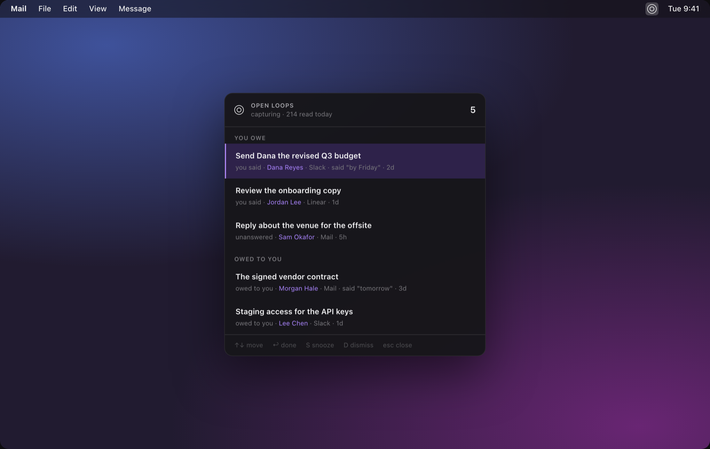
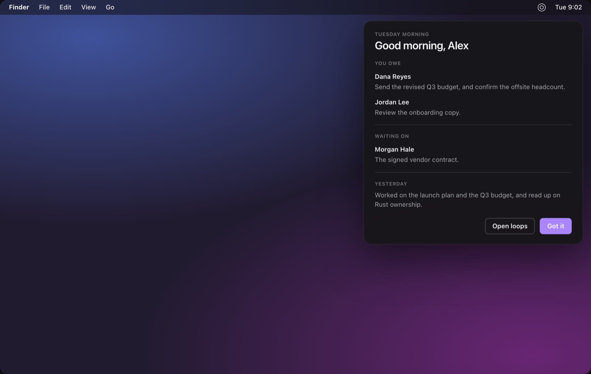
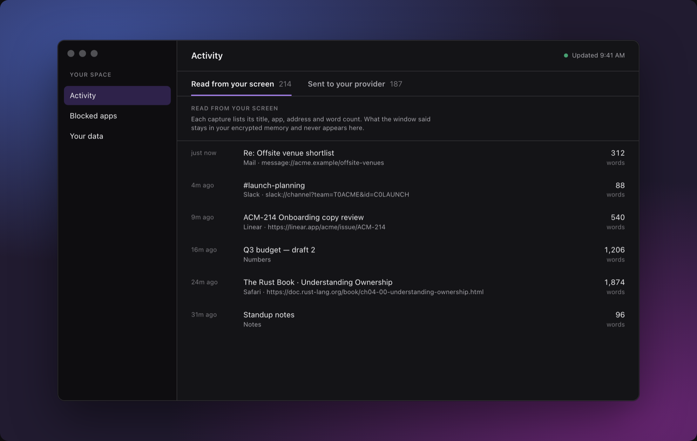
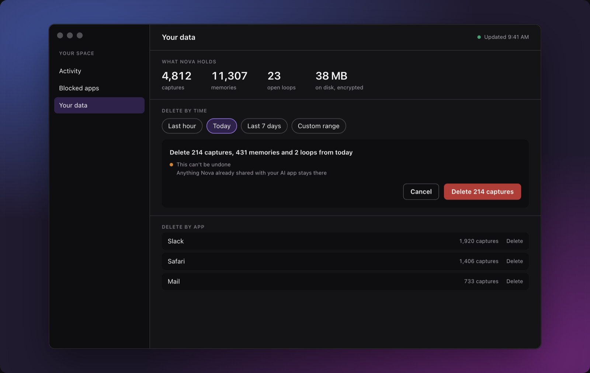

# Nova

**A private, encrypted memory of what you read on your Mac, and a list of
the things you said you would do.**

Nova is a macOS menu-bar app. It reads the window in front of you, keeps what
matters in an encrypted store on your Mac, and lets any AI assistant that
speaks [MCP](https://modelcontextprotocol.io) search it. It also finds your
*open loops*: the replies you owe, the questions nobody answered, and the
things other people promised you. When a later screen shows a loop is done,
Nova closes it.

> **Status: early.** Nova works end to end, but you build it from source and
> it is not signed for other Macs yet. Expect rough edges.
> See [docs/roadmap.md](docs/roadmap.md).



## What it does

- **Remembers what you read.** Every 3 seconds Nova reads the frontmost
  window through the macOS Accessibility API, skips menus and sidebars, and
  ignores text it has already seen. Apps that expose no text are read with
  on-device OCR.
- **Answers your AI assistant.** Claude Desktop, Claude Code and other MCP
  clients can ask "what did Dana say about the launch date?" and get an answer
  with the app, window and time it came from.
- **Tracks open loops.** "I'll send the deck tomorrow" becomes a loop you owe.
  "Can you review this?" with no reply becomes an unanswered one. Every loop
  quotes the line it came from, and Nova would rather miss a loop than invent
  one.
- **Shows its work.** *Your Space → Activity* lists what Nova read and every
  call that left your Mac, as sizes, never content.
- **Forgets on request.** Delete by time, by app or everything. Raw capture
  text expires after 90 days by default.

## Privacy, in short

- Everything Nova stores is encrypted: SQLCipher over the whole file, plus
  AES-256-GCM on every field that quotes your screen. The keys are per install
  and live in your Keychain.
- Banking sites, private-browsing windows and screen shares are refused before
  Nova reads them. You can block any other app or site.
- Card numbers and CVVs, bank and national ID numbers, and one-time codes are
  redacted before storage. Emails and phone numbers are stripped from
  anything sent out.
- **What leaves your Mac:** capture text, your open-loop descriptions, the
  extracted memories, your search queries and the inputs to the morning
  briefing go to the AI provider *you* configure. Nothing goes to the authors
  of Nova. Point Nova at a local OpenAI-compatible server and nothing leaves
  at all.

Details: [docs/privacy.md](docs/privacy.md).

## Screenshots

| | |
|---|---|
|  |  |
| **Morning briefing.** What you owe, what you are waiting on, and what yesterday came to. | **Activity.** Every capture and every call to your provider, as metadata, never content. |
|  | |
| **Your data.** See what Nova holds, and delete by time, by app or everything. | |

Screenshots use fictional people and data.

## Requirements

- macOS 14 or later, Apple silicon or Intel
- Xcode command line tools (Swift 6)
- [Bun](https://bun.sh) 1.3 or later
- SQLCipher: `brew install sqlcipher`
- An AI provider: a Gemini API key, any OpenAI-compatible endpoint, or a local
  server. See [docs/providers.md](docs/providers.md).

## Quick start

```sh
git clone https://github.com/cybertron288/nova-memory.git
cd nova-memory
cp .env.example .env              # then add your provider key
(cd daemon && bun install)
scripts/build-app.sh --run        # builds, signs locally and opens Nova
```

Grant Accessibility when macOS asks (Screen Recording is optional and enables
OCR). Then connect your assistant:

```sh
claude mcp add --scope user nova -- bun --cwd "$PWD/daemon" src/cli.ts mcp
```

The full guide, including Claude Desktop, is [docs/install.md](docs/install.md).

## Documentation

| For | Read |
|---|---|
| Using Nova | [install](docs/install.md) · [privacy](docs/privacy.md) · [providers](docs/providers.md) · [FAQ](docs/faq.md) · [troubleshooting](docs/troubleshooting.md) · [uninstall](docs/uninstall.md) |
| Running it day to day | [RUNNING.md](RUNNING.md) |
| Contributing | [CONTRIBUTING.md](CONTRIBUTING.md) · [architecture](docs/architecture.md) · [data model](docs/data-model.md) · [glossary](docs/glossary.md) |
| Design and decisions | [docs/README.md](docs/README.md) |

## Project layout

| Directory | What it is |
|---|---|
| `capture/` | `nova-capture` (Swift): reads the frontmost window and emits one JSON line per capture |
| `daemon/` | `nova` (TypeScript, Bun): the encrypted store, extraction, open loops, MCP server and control socket |
| `shell/` | `NovaShell` (Swift): the menu-bar app; it supervises the daemon |
| `docs/` | Architecture, data model, decisions, design specs |
| `spikes/` | Early feasibility experiments, kept for reference |

## Contributing

Bug reports, fixes and ideas are welcome. Start with
[CONTRIBUTING.md](CONTRIBUTING.md). Report security problems privately, as
described in [SECURITY.md](SECURITY.md). Everyone taking part follows the
[Code of Conduct](CODE_OF_CONDUCT.md).

## License

Copyright (C) 2026 Ravi Patel.

Nova is free software under the [GNU Affero General Public License v3.0 or
later](LICENSE). Third-party components are listed in
[THIRD_PARTY.md](THIRD_PARTY.md).
