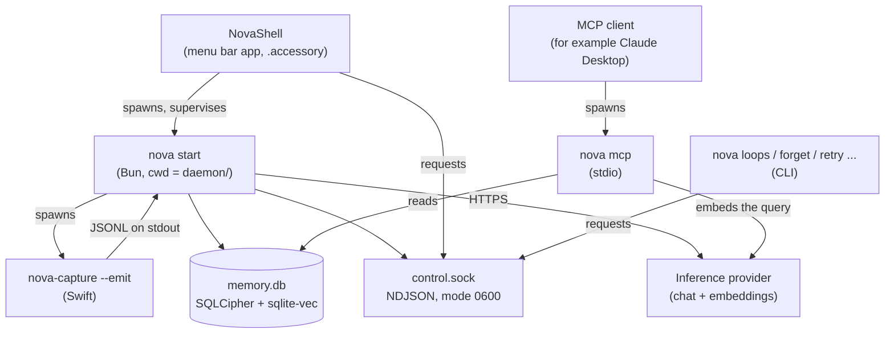
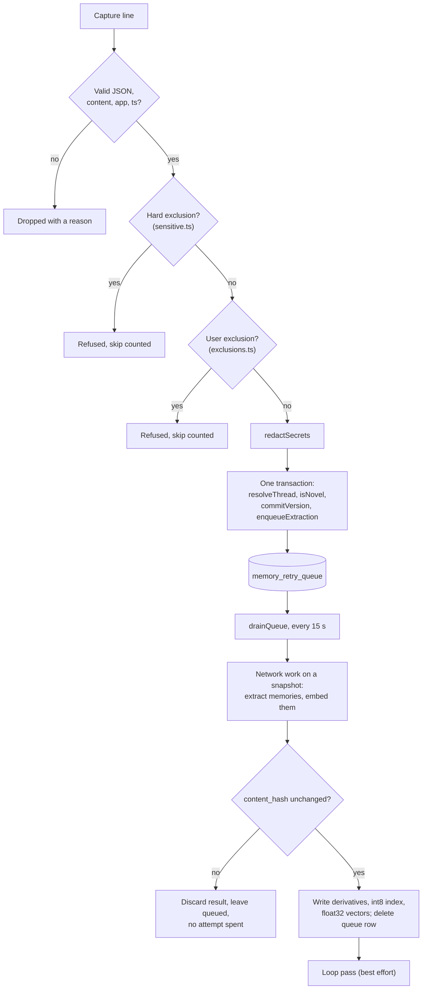

# Nova architecture

This document describes Nova as it is built today. It is for contributors who
want to know where things live, how data moves, and which rules the code
depends on. For the meaning of a term, see [glossary.md](glossary.md). For the
tables and wire contracts, see [data-model.md](data-model.md). Decision IDs
(R1–R11) are defined in [decisions.md](decisions.md); feature IDs (F1–F7) in
[features.md](features.md); deferred work (D1–D28) in
[deferred-tasks.md](deferred-tasks.md).

## 1. Overview

Nova is a macOS menu-bar app. It reads the text of the frontmost window, stores
it encrypted on the Mac, extracts short memories and open loops from it with a
language model that you configure, and serves the result to AI apps over MCP.

There is no Nova server. There is no account. The only network traffic is to
the inference provider you configure (see [providers.md](providers.md)), and
whatever an MCP client does with the results it asks for.

The code is in three directories:

| Directory | Product | Language | Role |
|---|---|---|---|
| `capture/` | `nova-capture` | Swift | Reads the frontmost window through the Accessibility (AX) API every 3 s. Falls back to OCR. Writes one JSON line per capture to stdout. |
| `daemon/` | `nova` | TypeScript on Bun | Owns the encrypted store. Ingests captures, calls the provider, serves the control socket and MCP. |
| `shell/` | `NovaShell` | Swift (AppKit, SwiftUI) | Menu-bar item, panel, inspector, morning digest card, Your data pane. Supervises the daemon. |

## 2. Processes

### 2.1 The shell supervises the daemon

`shell/Sources/NovaShell/Supervisor.swift` starts the daemon as
`bun src/cli.ts start` with the working directory set to `daemon/`.

- **The working directory matters.** `.env` is at the repo root and
  `daemon/.env` is a symlink to it. Bun loads `.env` from the process working
  directory. A daemon started from the repo root loads no provider keys and
  fails with a provider error, not a missing-file error.
- **Finding Bun.** The supervisor does not use `PATH`, because an app opened
  from Finder has none. It checks `NOVA_BUN`, then the usual install
  locations. It finds the daemon source through `NOVA_DAEMON_DIR`, or by
  walking up from the shell binary to `daemon/src/cli.ts`.
- **Capture binary.** The shell sets `NOVA_CAPTURE_BIN` to the capture binary
  inside the app bundle, unless that variable is already set. This makes
  capture run under Nova.app's code signature and its Accessibility grant.
- **Adoption.** If a daemon already answers on the control socket (for
  example, one you started by hand), the supervisor watches it and does not
  start a second one.
- **Backoff.** Restart delay starts at 1 s and doubles to 60 s. The streak
  resets after 5 minutes of uptime, or after a clean exit. After 10
  consecutive failures the supervisor stops and the menu offers Restart.
- **Exit codes.** Exit code 0 means the daemon was stopped on purpose (SIGTERM
  or SIGINT, or capture exited). It resets the failure streak, because `pkill`
  is the normal way to restart the daemon during development. Any other exit
  is a failure.
- **Stop.** On quit, the shell sends SIGTERM, waits up to 3 s, then sends
  SIGKILL. It does not stop a daemon it adopted.
- **Log.** The supervisor writes daemon output to
  `~/Library/Logs/Nova/daemon.log` (mode 0600, because it names loops in plain
  text). A log older than a week is moved to `daemon.log.1`, so at most two
  weeks exist. `cd daemon && bun src/cli.ts logs` follows it with color.

### 2.2 The daemon

`nova start` (`daemon/src/cli.ts`) does these steps in order:

1. **Single instance.** It checks the pidfile
   `~/Library/Application Support/Nova/daemon.pid` before it opens the store.
   If a live daemon holds it, `start` exits 1. `--force` stops the other
   daemon first. Without this check, a second daemon would unlink and take the
   control socket. The first daemon would keep capturing, unreachable, and
   `pause` would reach only one of the two capture processes.
2. **Store.** It opens `~/Library/Application Support/Nova/memory.db` and
   reads the two keys from the Keychain (section 5).
3. **Provider probe.** `providerFromEnv` never throws, so the daemon tests it.
   If no provider is configured, or the configuration is incomplete, `start`
   prints the reason and exits 1 before it starts capture.
4. **Recovery.** It releases queue claims left by a previous run
   (`releaseStaleClaims`) and runs `purgeSecrets`, which applies the current
   credential rules and exclusion list to rows already stored.
5. **Control socket.** It binds
   `~/Library/Application Support/Nova/control.sock` and sets mode 0600.
6. **Capture.** It spawns `nova-capture --emit` and reads its stdout.
7. **Timers.** Every 15 s it runs the retention sweep if one is due, then
   drains the extraction queue.

**Capture exit stops the daemon.** When capture's stdout closes, the daemon
shuts down with exit code 0, and the supervisor restarts both. A daemon with
no capture is the state this avoids. In the other direction, `nova-capture`
watches its parent process with a kqueue process source and exits at once when
the parent exits, so a daemon killed with SIGKILL does not leave an orphan
capture process.

### 2.3 Which processes open the store

The store is a SQLCipher file. These commands open it directly:

| Command | Opens the store | Notes |
|---|---|---|
| `nova start` | yes | The daemon. The only writer during normal use. |
| `nova mcp` | yes | Started by an MCP client, in its own process. Reads only. |
| `nova search`, `nova status` | yes | Terminal tools. |
| `nova loops`, `done`, `snooze`, `dismiss`, `pause`, `resume`, `precision`, `exclude`, `exclusions`, `unexclude`, `calls`, `retry`, `forget` | no | They send one request to the control socket and print the reply. |
| NovaShell | no | All reads and actions go through the control socket. |

The shell never opens the store and never holds the field key. Any new UI
feature must go through a control-socket op. `sqlite3` cannot open the file,
because it is encrypted.

## 3. Capture

`nova-capture` (`capture/Sources/nova-capture/main.swift`, logic in
`capture/Sources/NovaCaptureKit/`) runs a loop: read the window, decide, emit,
sleep 3 s.

**Content and chrome.** `AXReader` walks the frontmost window's AX tree and
splits it into content (the document or conversation) and chrome (sidebars,
toolbars, labels). `ContentScoring` picks the content region by geometry and
focus, never by app identity. When a region has keyboard focus, the smallest
focused region wins, because focus is also reported on every enclosing pane.
Role-based scoring was tried and failed: it picked Slack's channel list, and
`AXWebArea`-based scoring picked VSCodium's file tree.

**OCR fallback.** `OCRGate` runs OCR (Apple Vision) only when the AX content
is under 200 characters, or is under 25% of the window's total text. Both
tests are needed: a window can pass the character floor while its "content" is
a fragment of a file tree. `OCRThrottle` limits OCR to once per 15 s per
window. It checks the interval before it takes a screenshot, and it compares a
pixel fingerprint before it runs Vision.

**Self-output.** `SelfOutput.strip` removes Nova's own JSON lines from the
text. A terminal that shows its scrollback through AX would otherwise capture
the capture stream.

**Novelty.** Capture keeps the last emitted text per app and emits a new
record only when word-shingle Jaccard similarity to it is below 0.85.

**Wire format.** One `CaptureRecord` per line on stdout:
`ts`, `app`, `bundleId`, `windowTitle`, `url` (browsers only), `content`,
`contentHash`, and `treeHash`. `treeHash` is present only when `content` is
the AX text unchanged. All diagnostics go to stderr, one write per line,
because stdout is the wire.

`--app <name>` reads a named app instead of the frontmost window. It is a
diagnostic flag, and capture refuses to combine it with `--emit`.

## 4. Pipeline

### 4.1 Ingest

`ingestStream` (`daemon/src/ingest.ts`) reads lines and calls `handleLine` for
each one. While capture is paused, lines are read and counted but not stored.
Every rejection has a named reason (`malformed-json`, `empty-content`,
`sensitive-source`, `user-excluded`, `duplicate-fingerprint`, `write-failed`,
and others), and the counts go to the log every 10 lines. An empty store must
be explainable from the log alone.

`handleLine` does this:

1. **Validate** the record.
2. **Hard exclusions** (`deniedSourceRule` in `daemon/src/sensitive.ts`).
   These refuse the whole capture before it reaches the store or any provider.
   They cannot be turned off. The categories are password managers and
   password pages, banking and payment sites (matched on the host), private
   browsing windows, and screen sharing or meeting apps.
3. **User exclusions** (`userExcludedRule` in `daemon/src/exclusions.ts`).
   Apps (by bundle id or name) and domains (including subdomains) that the
   user added. This list only adds refusals.
4. **Redaction** (`redactSecrets`). Credential-shaped spans become
   `[redacted]`: labelled secrets, bearer tokens, one-time codes, card
   numbers, and national ID and bank account formats.
5. **One transaction** over `resolveThread`, `isNovel`, `commitVersion` and
   `enqueueExtraction`. These must commit together. `isNovel` records the
   fingerprint as a side effect. If the fingerprint committed and a later step
   threw, the same capture would be refused as a duplicate forever.

### 4.2 Threads and versions

A **thread** is one source: a browser page identified by its normalized URL
(query string and fragment removed), or any other window identified by its
title. The identity string is never stored. `source_key` holds an HMAC of it
(section 5).

A **version** is the thread's text for one hour. `commitVersion` keeps one
mutable head version per thread. A capture in the same hour as the head (or
earlier, after clock skew) overwrites the head and deletes the head's
derivatives, vectors and evidence links. A capture in a later hour freezes the
head and starts a new version.

### 4.3 Deduplication

| Layer | Where | What it catches |
|---|---|---|
| Jaccard novelty, threshold 0.85 | `capture/Sources/NovaCaptureKit/Novelty.swift` | Repeated reads of a window that has not changed much. |
| Fingerprint | `daemon/src/fingerprint.ts` | Exact repeats. SHA-256 of the content after relative times ("3 minutes ago", "yesterday", "5h ago") are replaced with one token, so a clock ticking in the UI does not make an unchanged conversation new. |
| Hourly versions | `daemon/src/threads.ts` | Many captures of one thread in one hour become one version. |
| Added lines | `daemon/src/pipeline.ts` | Extraction reads only the lines a version adds to the previous version, when the previous version's memories exist. |

The daemon stores `treeHash` in `memory_threads.last_tree_hash`, but no code
compares it today.

### 4.4 Drain, retry and park

`drainQueue` (`daemon/src/pipeline.ts`) runs every 15 s on its own timer, so a
slow provider never blocks ingest.

- **Claim.** Due rows are claimed inside a transaction (`status =
  'processing'`, `claimed_at`), oldest version first. A claim older than 10
  minutes can be taken again, which recovers rows held by a process that died.
  At startup, every `processing` row is released.
- **Network first.** All provider calls run against a decrypted snapshot of the
  content. Ingest runs on the same event loop, so a same-hour overwrite can
  land during an `await`.
- **Commit.** One transaction re-reads `content_hash`. If it changed, the
  result is discarded and the row is released without spending an attempt.
  Otherwise the transaction deletes any earlier output for the version, writes
  the new derivatives and vectors, marks the version `completed`, and deletes
  the queue row.
- **Failure.** An attempt fails with backoff `min(60 s × 2^n, 1 h)`. The claim
  is released with the backoff. Otherwise the next drain would skip the row
  until the claim timed out.
- **Park.** After 8 failed attempts the row is parked: `parked_at` is set,
  `last_error` is stored encrypted, and the version is marked `failed`. The row
  stays in the queue. The shell's Your Space window and `nova retry` re-queue it
  with a fresh budget. **A queue row leaves only when its capture succeeds.**
- **No attempt spent.** A quota refusal (`QuotaExhausted`: HTTP 429, 402, or a
  quota message in the body), an unreachable provider (`ProviderUnreachable`),
  and a content change during extraction do not count toward the 8 attempts.
  An unreachable provider pauses every drain for 60 s (`Reachability`), or
  until the shell sees the network path return and sends `network_up`, which
  drains at once.
- **Malformed responses.** A 200 response that is truncated, empty, or has no
  `memories` array throws `MalformedResponse` and spends an attempt. Only an
  explicit `{"memories": []}` means "nothing to extract".
- **One quota gate.** A quota refusal from chat or from embeddings pauses both,
  with backoff from 60 s to 1 h (or the `Retry-After` header). When the pause
  ends, the side that refused is asked first.
- **Loop pass outside the commit.** The loop pass runs after the commit and is
  best effort. If it fails, the version still counts as done, so correct
  memories are not extracted and paid for again.

## 5. Encryption

There are two layers.

1. **SQLCipher** encrypts the whole database file. The daemon sets the key
   before any other statement. The store runs in WAL mode with
   `secure_delete = ON`. The database, WAL and SHM files are mode 0600.
2. **Field encryption** with AES-256-GCM on every column that quotes the
   screen. The stored format is `enc:v1:` followed by base64 of IV (12 bytes),
   tag (16 bytes) and ciphertext.

**Keys.** Two random 32-byte keys are stored in the macOS Keychain as generic
passwords under the service `dev.nova.keys`, with the accounts `db`
(SQLCipher) and `field` (AES-GCM and HMAC). They are created on first use.
They are never constants in source and never derived from facts about the
machine. If the Keychain read fails for any reason other than "item not
found", the daemon stops. It does not create a new key, because a new key
would orphan the existing store. Tests use a separate service name through
`NOVA_KEYCHAIN_SERVICE`.

**Lookup digests.** A value that must stay secret but also serve an equality
lookup or a UNIQUE constraint is stored as `lookupDigest`: HMAC-SHA256 with the
field key. AES-GCM output is random, so it cannot be a lookup key. A plain
SHA-256 cannot either, because the set of URLs one person visits is small
enough to guess offline.

**Encrypted columns:** `memory_threads.source_title`,
`memory_threads.source_url`, `memory_versions.content`,
`memory_derivatives.content`, `open_loops.description`,
`open_loops.closure_sig`, `memory_retry_queue.last_error`,
`user_exclusions.value`, `user_exclusions.label`.

**Plaintext by design:** app names, `source_key` (an HMAC), content hashes,
timestamps, and a loop's `direction`, `counterparty`, `due_signal` and
`state`. Note that `due_signal` is a verbatim quote and is not encrypted.
[data-model.md](data-model.md) lists every column.

## 6. Search

`search_memory` and `nova search` call `searchMemory` (`daemon/src/search.ts`).

1. Embed the query with the provider. The vector must have 1536 dimensions
   (`DIM` in `daemon/src/provider.ts`). If it does not, search fails with an
   error. It does not return an empty result.
2. Scale the query to unit length and quantize it to int8.
3. KNN over `memory_derivative_embeddings` (a sqlite-vec `vec0` table of
   `int8[1536]`) for the 500 nearest candidates.
4. Rescore each candidate exactly against its float32 vector in
   `memory_derivative_vectors`: `0.85 × dot product + 0.15 × recency`, where
   recency halves every 30 days.
5. Return the top results (default 10), with text, time, app, and URL or
   window title.

Notes for contributors:

- The quantization scale is discarded. The int8 column cannot be turned back
  into float32 alone. The float32 sidecar is the source of truth for scoring.
- Stored vectors are unit length, so the dot product is cosine similarity.
- `OVER_FETCH = 500` was measured at about 120,000 rows, where it is about
  0.4% of the corpus. It is a fraction, not a fixed depth. Re-measure with
  `daemon/bench/vector-precision.ts` when the corpus grows by an order of
  magnitude.
- Write int8 vectors with `vec_int8(JSON.stringify(...))`. sqlite-vec reads a
  raw buffer bound to an `int8[]` column as float32 and stores garbage.
- `quantize` exists in both `pipeline.ts` and `search.ts`. The two must stay
  identical.
- The store records its embedding width in `store_metadata.embedding_dim` and
  refuses to open with a different `DIM`. There is no automatic migration.

## 7. Open loops

A loop is something unfinished: a promise the user made (`i_owe`), a promise
made to the user (`owed_to_me`), a question to the user with no reply
(`unanswered`), or an agreed step that did not happen (`stalled`). The code is
in `daemon/src/loops.ts`, and the prompt and parser are in
`daemon/src/provider.ts`.

Precision is the main constraint. A missed loop costs nothing the user sees.
An invented loop teaches the user to ignore the list. All extraction runs at
temperature 0.

**Skipped sources.** `watchesForLoops` skips AI assistants (ChatGPT, Claude,
Gemini, Copilot, Perplexity), terminals, code editors, Finder and Activity
Monitor before any model call.

**Parser gates.** `parseLoops` enforces these rules in code, even though the
prompt states them, because the model still breaks them at temperature 0:

1. **Quoted evidence.** The evidence must appear in the capture text, after
   normalizing case, punctuation and line breaks. This applies to closures
   too.
2. **New evidence.** For a thread's later versions, the evidence must be in
   the lines this version added. Otherwise a notes-to-self chat raises its
   whole backlog on every read.
3. **Direction fits the author.** When the user's identity is configured
   (the Profile pane, or `NOVA_USER_NAME` / `NOVA_USER_ALIASES`), the direction must fit who wrote
   the evidence line. The user's line can be `i_owe` or `owed_to_me`. Another
   person's line can be `owed_to_me` or `unanswered`. A line with no
   recognizable author is dropped. `stalled` is exempt.
4. **Names and dates from the text.** A counterparty whose first name is not
   in the text, or a due phrase that is not quoted from it, is cleared.

**Closing loops.** Up to 40 open loops are shown to the model with each
capture, under short ids (`L1`, `L2`, ...). The model can close one only by
quoting the line that shows it finished. Closure by semantic similarity is not
allowed: in testing, cosine matching closed many loops wrongly, often against
memories of the same capture that opened them.

**Deduplication.** `dedup_key` is a SHA-256 of direction, counterparty and the
normalized description. A verbatim restatement hits `ON CONFLICT DO NOTHING`,
which also keeps a dismissed loop dismissed. Semantic dedup embeds closure
signatures and treats a match at cosine 0.88 or higher (same direction, open
or snoozed loops only) as a restatement. A restatement updates the existing
loop in place and keeps its id, state and age.

**User actions.** `done` sets `user_resolved`, which is kept separate from
`auto_resolved` so the two can be compared. `snooze` hides a loop until a time
(default: the next 09:00 local). `dismiss` is permanent. Rating a loop "not
real" also dismisses it. `wakeExpiredSnoozes` runs whenever loops are offered
to the model, so no scheduler is needed.

**Age.** A loop's `created_at` is the capture time, not the extraction time.

**Morning digest.** `daemon/src/digest.ts` groups open loops by person. If the
provider supports it, the model writes one sentence per group and one line
about the previous day. If the call fails or times out (20 s), plain lines are
used.

## 8. Deletion and retention

`daemon/src/forget.ts` implements delete and retention.

**Delete.** A delete names a scope: a time range, one app, or everything. One
transaction removes every row the scope reaches, children first:

- captures (`memory_versions`) in the scope, and their derivatives, int8 and
  float32 vectors, and queue rows;
- loops reached by the scope that nothing outside the scope still supports;
- evidence links and `resolve_evidence` pointers to deleted derivatives;
- fingerprints in the scope, so the same text can be captured again later;
- threads with no captures left;
- references to deleted captures in `provider_calls.capture_ids`. The call log
  itself stays, unless "delete everything" asks to clear it.

Nothing is soft-deleted. After the transaction the daemon checkpoints the WAL
(`TRUNCATE`). "Delete everything" also runs `VACUUM` and empties
`daemon.log`. The shell's Your data pane and `nova forget` show the counts
from `count_for_delete` before they delete.

**Retention.** Two settings in `store_metadata`:

- `rawDays` (default 90; options 7, 30, 90, 365, or forever). Older capture
  text is replaced with an encrypted empty string, and `raw_purged_at` is set.
  The row stays, so memories keep their parent. Its queue row is removed.
- `memoryDays` (default forever; option 365). Older captures are deleted
  through the normal delete path.

The sweep runs at most once a day. It is checked on the 15 s drain timer
against the last sweep time stored in the database, so it does not drift.

**Rule for contributors:** any new table or column that holds data derived
from a capture must be added to `deleteScope`. `daemon/test/forget.test.ts`
lists the tables it checks.

## 9. MCP server

`nova mcp` (`daemon/src/mcp.ts`) serves MCP over stdio with the official
TypeScript SDK. An MCP client such as Claude Desktop starts it as a
subprocess. Provider settings go in the client's `env` block for the server.

| Tool | Input | Provider call |
|---|---|---|
| `search_memory` | `query` (string, required), `limit` (number, default 10) | Yes. One embedding of the query. |
| `get_open_loops` | `direction` (`i_owe`, `owed_to_me`, `unanswered`, `stalled`, `any`; default `any`), `limit` (number, default 20, clamped to 1–100) | No. Reads stored loops. |
| `get_timeline` | `from` (ISO 8601 date or date-time, required), `to` (same, default now; a bare date includes that day), `limit` (number, default 50, clamped to 1–200) | No. Reads stored memories. |

Each tool returns one text block. Each result line carries its time and source
so the model can cite it. Loop lines also carry the loop id, which
`nova done|snooze|dismiss` accepts.

`providerFromEnv` never throws at construction. With no provider configured,
`nova mcp` still starts, and a tool call returns an error that names the
missing variables. Nothing reachable from `nova mcp` may write to stdout,
because stdout is the JSON-RPC wire.

## 10. What is sent to the provider

| Call | Purpose label | Content sent |
|---|---|---|
| Extract memories | `memories` | The capture text (only the new lines, when an earlier version was extracted), up to 3000 characters of the earlier version as context, app name, window title, URL, capture time, and the user's configured name and aliases. |
| Embed memories | `memories` | The extracted memory sentences. |
| Extract and close loops | `loops` | The full capture text, the added lines, the same context fields, and up to 40 open loop descriptions with their direction and counterparty. |
| Restatement check | `loops` | Closure signatures of open loops and of new candidates (embeddings). |
| Morning digest | `digest` | Up to 50 open loop descriptions grouped by counterparty, up to 60 memories from the previous day, and the user's name. |
| Quota probe | `probe` | The fixed text `quota check`. |
| Search query | (none) | The query text from `search_memory` or `nova search`. |

Before extraction, loop and embedding calls, `redactOutbound` replaces email
addresses with `[email]` and phone numbers with `[phone]` in the text and in
the title, URL and context fields. Credentials were already removed at ingest.
The digest call does not apply `redactOutbound`.

The daemon records every call it makes in `provider_calls`: provider host,
model, kind, outcome, duration, character count, item count, status, purpose,
and capture ids. It never records the prompt or the reply. The shell's
inspector and `nova calls` read this log. `nova mcp` and `nova search` record
their query embeddings too, with the purpose `search`.

Provider selection is described in [providers.md](providers.md). In short: if
any of the six `NOVA_CHAT_*` / `NOVA_EMBED_*` variables is set, Nova uses the
OpenAI-compatible provider and requires all six. Otherwise `GEMINI_API_KEY`
selects Gemini. Otherwise every call fails with an error that names both
options. See [privacy.md](privacy.md) for the user-facing account.

## 11. Shell

`shell/Sources/NovaShell/` is an AppKit app with the `.accessory` activation
policy (menu bar only, no Dock icon). It talks to the daemon only through
`ControlClient.swift`, which uses the control socket. `NOVA_CONTROL_SOCKET`
overrides the socket path for the shell only. The daemon always binds the
default path.

Main parts:

- `StatusItem.swift`: the menu-bar glyph and menu. The glyph state comes from
  the daemon's `status` reply.
- `PanelWindow.swift`, `PanelView.swift`, `PanelModel.swift`: the loops and
  memory panel, paged with `list_loops_page` and `list_memories_page`.
- `InspectorWindow.swift`, `InspectorView.swift`: the Your Space window. It
  shows recent captures, the provider call log, and parked captures.
- `DigestCard.swift`, `DigestScheduler.swift`: the morning digest card.
- `YourDataView.swift`: counts, delete and retention.
- `BlockedAppsView.swift`, `AddRuleForm.swift`: hard and user exclusions, with
  skip counts.
- `Permission.swift`, `PermissionsView.swift`: the Accessibility and Screen
  Recording checks, and the Permissions pane that shows them.

Visual rules are in [design/design-system.md](design/design-system.md) and
[design/motion-spec.md](design/motion-spec.md).

## 12. Rules that are easy to break

1. Opening the store from the shell, or from any new process, instead of
   adding a control-socket op.
2. Running the daemon from the repo root instead of `daemon/`.
3. Setting some of the six `NOVA_*` provider variables and expecting a
   fallback to `GEMINI_API_KEY`.
4. Adding a column that holds screen content without `encryptField`, or an
   equality lookup on secret data without `lookupDigest`.
5. Binding a raw buffer to a `vec0` `int8[]` column.
6. Changing `DIM`, or letting the two `quantize` functions differ.
7. Removing a `parseLoops` gate because the prompt already states the rule.
8. Writing to stdout from code reachable by `nova mcp` or
   `nova-capture --emit`.
9. Coercing an invalid value at the socket or CLI boundary instead of
   refusing it. An unknown filter must return an error, not the unfiltered
   default with `ok: true`.
10. Dropping a capture, loop or queue row without a logged reason.
11. Adding capture-derived data without adding it to `deleteScope`.

## 13. Not built yet

These are designed or planned but are not in the code:

- **Audio capture and transcription.** Nova reads text only.
- **Onboarding.** There is no first-run flow. Setup is manual: see
  [../RUNNING.md](../RUNNING.md).
- **Signed and notarized build.** The app is signed with a local development
  identity, and the daemon runs from the source checkout with Bun. Nova does
  not yet run on a Mac without a source checkout (D27 in
  [deferred-tasks.md](deferred-tasks.md)).
- **Automatic updates.**
- **Hosted relay, accounts, remote MCP.** There is no Nova server. MCP is
  local stdio only (D28).
- **Entity graph.** People, projects and facts as tables are designed in
  [entity-graph-design.md](entity-graph-design.md) but not built. Loops store
  the counterparty as a plain name string (D11).
- **Local embeddings.** Embeddings come from the configured provider. A local
  model is planned in
  [local-embeddings-experiment.md](local-embeddings-experiment.md).
- **The `candidate` loop state.** It is in the schema, but every new loop is
  stored as `open`.
