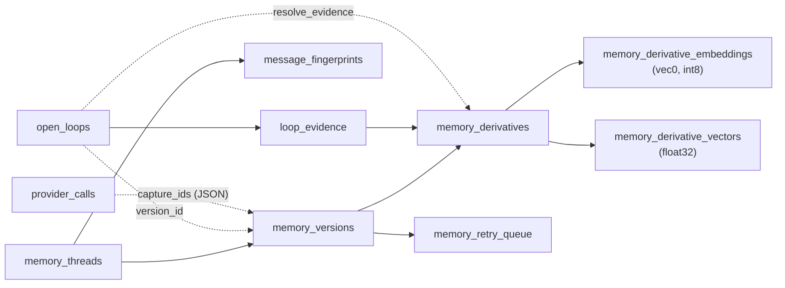

# Nova data model

This document lists every table and column the daemon creates, the
`store_metadata` keys, the control-socket protocol, and the MCP tool
contracts. The source of truth is the code:

- schema and migrations: `daemon/src/db.ts`
- control socket: `daemon/src/control.ts`
- MCP server: `daemon/src/mcp.ts`

If this document and the code disagree, the code is right and this document
needs a fix. For how the pieces fit together, see
[architecture.md](architecture.md). For terms, see [glossary.md](glossary.md).

## 1. The store

| Property | Value |
|---|---|
| Path | `~/Library/Application Support/Nova/memory.db` (plus `-wal` and `-shm`) |
| File permissions | 0600 |
| Engine | SQLite through `bun:sqlite`, with SQLCipher loaded as the SQLite library |
| Extension | sqlite-vec, for the `vec0` virtual table |
| Pragmas | `key` (set first), `journal_mode = WAL`, `foreign_keys = ON`, `secure_delete = ON` |
| SQLCipher key | Keychain service `dev.nova.keys`, account `db` |
| Field key | Keychain service `dev.nova.keys`, account `field` |

Only the daemon writes to the store during normal use. `nova mcp`,
`nova search` and `nova status` open it to read. The shell never opens it.

### 1.1 Column markers

- **enc**: encrypted with AES-256-GCM using the field key. Stored as
  `enc:v1:` + base64(IV 12 bytes, tag 16 bytes, ciphertext).
- **hmac**: HMAC-SHA256 with the field key, hex. Serves equality lookups and
  UNIQUE constraints without storing the value.
- **sha256**: an unkeyed SHA-256, hex.
- Times are Unix epoch milliseconds unless noted.
- Ids are random UUIDs, except `open_loops.id`, which is a time-ordered
  UUIDv7-style id built from the capture time.

### 1.2 Overview



Dashed lines are references without a foreign key constraint, except
`open_loops.resolve_evidence`, which does have one.

## 2. Tables

### 2.1 `memory_threads`

One row per source: a browser page, or a window of another app.

| Column | Type | Marker | Notes |
|---|---|---|---|
| `id` | TEXT PK | | |
| `source_app` | TEXT NOT NULL | plaintext | App name, for example `Slack`. |
| `source_key` | TEXT NOT NULL | hmac | Digest of the normalized URL (scheme, host and path; no query or fragment) for a browser, or of the window title otherwise. |
| `source_title` | TEXT | enc | Window title at thread creation. |
| `source_url` | TEXT | enc | Normalized URL. NULL for non-browser captures. |
| `last_message` | TEXT | | Not written by current code. |
| `last_timestamp` | INTEGER | | Capture time when the thread was created. Not updated later. |
| `last_tree_hash` | TEXT | plaintext | `treeHash` of the latest capture. Stored, not compared. |
| `created_at` | INTEGER NOT NULL | | Capture time of the first capture. |
| `updated_at` | INTEGER NOT NULL | | Capture time of the latest capture. |

Constraints: `UNIQUE(source_app, source_key)`. Index `idx_threads_updated` on
`updated_at`.

### 2.2 `memory_versions`

A thread's captured text for one hour. Called a "capture" in the UI and in
`forget.ts`.

| Column | Type | Marker | Notes |
|---|---|---|---|
| `id` | TEXT PK | | |
| `thread_id` | TEXT NOT NULL | | FK to `memory_threads(id)`. |
| `hour_bucket` | INTEGER NOT NULL | | `floor(ts / 3600000)`. |
| `content` | TEXT NOT NULL | enc | The captured text, after credential redaction. Encrypted empty string after retention removes it. |
| `content_hash` | TEXT NOT NULL | sha256 | `contentHash` from the capture record: `sha256:` plus the hash of the text as captured, before the daemon's redaction. The drain re-reads it to detect a change during extraction. |
| `word_count` | INTEGER NOT NULL DEFAULT 0 | | |
| `is_frozen` | INTEGER NOT NULL DEFAULT 0 | | 0 for the thread's one mutable head, 1 after a later hour starts. |
| `metadata` | TEXT | | Not written by current code. |
| `parent_version_id` | TEXT | | The previous head, when one existed. |
| `committed_at` | INTEGER NOT NULL | | Capture time. Updated when the head is overwritten in the same hour. |
| `embedding_status` | TEXT NOT NULL DEFAULT `'pending'` | | `pending`, `completed`, or `failed` (parked). |
| `raw_purged_at` | INTEGER | | Set when retention blanks `content`. Added by migration. |

Index `idx_versions_thread_mutable` on `(thread_id, is_frozen)`.

### 2.3 `memory_derivatives`

The memories extracted from a version. This is the unit that search returns.

| Column | Type | Marker | Notes |
|---|---|---|---|
| `id` | TEXT PK | | |
| `thread_id` | TEXT NOT NULL | | FK to `memory_threads(id)`. |
| `version_id` | TEXT NOT NULL | | FK to `memory_versions(id)`. |
| `content` | TEXT NOT NULL | enc | One memory sentence. |
| `content_hash` | TEXT NOT NULL | sha256 | Of the memory text. |
| `committed_at` | INTEGER NOT NULL | | The version's capture time. |
| `embedding_status` | TEXT NOT NULL DEFAULT `'pending'` | | Written as `completed`: a derivative is stored only with its vector. |

Index `idx_derivatives_committed` on `committed_at`.

### 2.4 `memory_derivative_embeddings`

```sql
CREATE VIRTUAL TABLE memory_derivative_embeddings
  USING vec0(derivative_id TEXT PRIMARY KEY, embedding int8[1536]);
```

The KNN index. Each row is the derivative's unit vector quantized to int8 with
its own scale. The scale is not stored. Write rows with
`vec_int8(JSON.stringify(array))`, never with a raw buffer.

### 2.5 `memory_derivative_vectors`

| Column | Type | Notes |
|---|---|---|
| `derivative_id` | TEXT PK | Same id as the derivative. |
| `vector` | BLOB NOT NULL | 1536 float32 values, unit length. Used for the exact rescore. |

### 2.6 `message_fingerprints`

| Column | Type | Marker | Notes |
|---|---|---|---|
| `fingerprint` | TEXT PK | sha256 | Of the redacted content after relative times are replaced. |
| `thread_id` | TEXT NOT NULL | | The thread that first had this content. |
| `seen_at` | INTEGER NOT NULL | | Wall-clock time of ingest. |

The lookup is global, not per thread: the same text in two threads is stored
once.

### 2.7 `memory_retry_queue`

The extraction queue. A row leaves only when its version is extracted, or when
the version is deleted or blanked by retention.

| Column | Type | Marker | Notes |
|---|---|---|---|
| `id` | TEXT PK | | |
| `kind` | TEXT NOT NULL | | Always `'extract'` today. |
| `version_id` | TEXT | | The version to extract. |
| `attempts` | INTEGER NOT NULL DEFAULT 0 | | Failed attempts. Quota, unreachable-provider and content-change outcomes do not count. |
| `next_attempt_at` | INTEGER NOT NULL | | Not due before this time. |
| `status` | TEXT NOT NULL DEFAULT `'pending'` | | `pending` or `processing`. CHECK on new stores only. |
| `claimed_at` | INTEGER | | When a drain claimed the row. Reclaimable after 10 minutes. |
| `parked_at` | INTEGER | | Set after 8 failed attempts. Parked rows are not drained until retried. |
| `last_error` | TEXT | enc | One-line summary of the last failure. |

Constraint: `UNIQUE(kind, version_id)`.

### 2.8 `open_loops`

| Column | Type | Marker | Notes |
|---|---|---|---|
| `id` | TEXT PK | | Time-ordered id from the capture time. |
| `created_at` | INTEGER NOT NULL | | Capture time of the version that raised the loop. |
| `description` | TEXT NOT NULL | enc | Model-written description. Replaced by a restatement. |
| `direction` | TEXT NOT NULL | plaintext | CHECK: `i_owe`, `owed_to_me`, `unanswered`, `stalled`. |
| `counterparty` | TEXT | plaintext | A name that appears in the capture, for example `Dana Reyes`. Not a foreign key. |
| `due_signal` | TEXT | plaintext | A timing phrase quoted from the capture, for example `by Friday`. |
| `due_at` | INTEGER | | Always NULL today. |
| `state` | TEXT NOT NULL | plaintext | CHECK: `candidate`, `open`, `auto_resolved`, `user_resolved`, `snoozed`, `dismissed`. New loops are `open`; `candidate` is not used. |
| `snoozed_until` | INTEGER | | Hidden until this time. |
| `closure_sig` | TEXT NOT NULL | enc | One sentence describing what would close the loop. Used for semantic dedup. |
| `resolved_at` | INTEGER | | Set by done, dismiss and auto-resolve. |
| `resolve_evidence` | TEXT | | FK to `memory_derivatives(id)`. The derivative of the capture that closed the loop. |
| `feedback` | INTEGER | | The user's rating: 1 real, -1 not real, NULL unrated. |
| `dedup_key` | TEXT NOT NULL | sha256 | Of direction, lowercased counterparty and normalized description. |
| `version_id` | TEXT | | The version that raised the loop. Added by migration. |

Constraint: `UNIQUE(dedup_key)`. Index `idx_loops_state` on
`(state, created_at)`.

### 2.9 `loop_evidence`

| Column | Type | Notes |
|---|---|---|
| `loop_id` | TEXT NOT NULL | FK to `open_loops(id)`. |
| `derivative_id` | TEXT NOT NULL | FK to `memory_derivatives(id)`. |

Primary key `(loop_id, derivative_id)`. A loop seen in three captures has
three rows. The shell reads the source app of a loop through this table.

### 2.10 `store_metadata`

| Column | Type |
|---|---|
| `key` | TEXT PK |
| `value` | TEXT NOT NULL |

Keys in use:

| Key | Written by | Value |
|---|---|---|
| `embedding_dim` | `assertEmbeddingDim` (`db.ts`) | `"1536"`. The store refuses to open with a different `DIM`. |
| `vectors_unit_length` | `migrateVectorsToUnitLength` (`db.ts`) | Time the one-time rescale of float32 vectors ran. |
| `retention_raw_days` | `setRetention` (`forget.ts`) | A number of days, or `"forever"`. Absent means 90. |
| `retention_memory_days` | `setRetention` (`forget.ts`) | A number of days, or `"forever"`. Absent means forever. |
| `retention_last_sweep` | `sweepRetention` (`forget.ts`) | JSON: `{ at, rawRemoved, deleted: { captures, memories, loops } }`. |
| `capture_paused` | `pause` / `resume` ops (`control.ts`) | `"1"` or `"0"`. Read at daemon start, so a pause survives a restart. |
| `user_identity` | `set_profile` op (`identity.ts`) | `encryptField` of JSON `{ name, aliases }`. Field-encrypted: a name and emails are personal data. Absent means fall back to `NOVA_USER_NAME` / `NOVA_USER_ALIASES`. Not capture-derived, so a delete leaves it. |

### 2.11 `provider_calls`

The log of what left the Mac. It holds metadata only: no prompt and no reply.
The newest 2000 rows are kept.

| Column | Type | Notes |
|---|---|---|
| `id` | TEXT PK | |
| `at` | INTEGER NOT NULL | |
| `provider` | TEXT NOT NULL | `gemini`, or the host of the configured base URL. |
| `model` | TEXT NOT NULL | |
| `kind` | TEXT NOT NULL | CHECK: `chat`, `embed`. |
| `outcome` | TEXT NOT NULL | CHECK: `ok`, `error`. |
| `ms` | INTEGER NOT NULL | Duration. |
| `input_chars` | INTEGER NOT NULL | Characters sent. |
| `items` | INTEGER NOT NULL | Prompts for chat, texts for an embed batch. |
| `status` | INTEGER | HTTP status on error. |
| `detail` | TEXT | Short failure reason. Never a response body. |
| `purpose` | TEXT | `memories`, `loops`, `digest`, `probe`, `search`. Added by migration. |
| `capture_ids` | TEXT | JSON array of `memory_versions` ids the call carried. Added by migration. |

Index `provider_calls_at` on `at DESC`.

### 2.12 `skip_counts`

How many windows each exclusion rule refused, ever.

| Column | Type | Notes |
|---|---|---|
| `rule_id` | TEXT PK | A hard rule id (`password-managers`, `banking`, `private-browsing`, `screen-sharing`) or a `user_exclusions.id`. No foreign key. |
| `skipped` | INTEGER NOT NULL DEFAULT 0 | |
| `last_at` | INTEGER | Last refusal. |

### 2.13 `user_exclusions`

| Column | Type | Marker | Notes |
|---|---|---|---|
| `id` | TEXT PK | | |
| `kind` | TEXT NOT NULL | plaintext | CHECK: `app`, `domain`. |
| `value` | TEXT NOT NULL | enc | A bundle id (lowercased), an app name, or a host without `www.`. |
| `value_key` | TEXT NOT NULL | hmac | Of `kind:value` lowercased. |
| `label` | TEXT | enc | Display name when `value` is a bundle id. Added by migration. |
| `created_at` | INTEGER NOT NULL | | |

Constraint: `UNIQUE(kind, value_key)`.

### 2.14 Migrations

`openDb` runs these after `CREATE TABLE IF NOT EXISTS`. Each one is
idempotent.

| Function | Change |
|---|---|
| `migrateRetryQueueClaims` | Adds `memory_retry_queue.status` and `claimed_at`. |
| `migrateRetryQueueParking` | Adds `parked_at` and `last_error`. Gives a parked queue row to each `failed` version that has none. |
| `migrateForgetColumns` | Adds `memory_versions.raw_purged_at` and `open_loops.version_id`. |
| `migrateExclusionLabels` | Adds `user_exclusions.label`. |
| `migrateProviderCallLinks` | Adds `provider_calls.purpose` and `capture_ids`. |
| `assertEmbeddingDim` | Records or checks `embedding_dim`. |
| `migrateVectorsToUnitLength` | Rescales stored float32 vectors to unit length, once. |

SQLite cannot add a CHECK constraint to an existing table. Stores created
before a CHECK was added do not have it.

## 3. Capture record

The wire from `nova-capture --emit` to the daemon. One JSON object per line.
Defined in `capture/Sources/NovaCaptureKit/CaptureRecord.swift` and
`daemon/src/threads.ts`.

| Field | Type | Notes |
|---|---|---|
| `ts` | number | Unix ms. |
| `app` | string | App name. |
| `bundleId` | string | Empty when unknown. |
| `windowTitle` | string | |
| `url` | string or null | Browsers only. |
| `content` | string | The content region's text, or OCR text. |
| `contentHash` | string | `sha256:` plus the SHA-256 of `content`. |
| `treeHash` | string, optional | `sha256:` hash of the whole AX tree. Present only when `content` is the unmodified AX text. |

## 4. Control socket

**Path:** `~/Library/Application Support/Nova/control.sock`, mode 0600.
**Framing:** newline-delimited JSON. One request object per line, one reply
per line. Replies carry the request's `id`. A reply can arrive out of order
(`morning_digest` is asynchronous), so match on `id`.

Request:

```json
{"id": "r1", "op": "list_loops", "direction": "i_owe", "limit": 20}
```

Reply:

```json
{"id": "r1", "ok": true, "result": [ ... ]}
{"id": "r1", "ok": false, "error": "unknown direction: \"owes_me\""}
```

Rules:

- A request with no `id` is refused. An unknown `op` is refused.
- A malformed line gets an `ok: false` reply. The connection stays open.
- A connection that sends more than 4 MiB without a newline is closed.
- Invalid values are refused, not replaced by a default.

### 4.1 Ops

**Status and capture**

| Op | Parameters | Result |
|---|---|---|
| `status` | none | `{ capturing, paused, queued, unreachableSince, lastCaptureAt, lastError, uptimeMs, pid }`. `queued` excludes parked rows. `unreachableSince` is epoch ms, or null while the provider answers. |
| `pause` | none | `{ paused: true }`. Capture keeps running; lines are not stored. |
| `resume` | none | `{ paused: false }` |
| `network_up` | none | `{}`. Ends the unreachable-provider wait and starts a drain. Sent by the shell when the network path returns. |

**Loops**

| Op | Parameters | Result |
|---|---|---|
| `list_loops` | `direction` (optional; `i_owe`, `owed_to_me`, `unanswered`, `stalled`, `any`), `limit` (default 20, clamped to 1–100) | `OpenLoop[]`, newest first. Shows `open` loops and `snoozed` loops whose time has passed. |
| `list_loops_page` | `after` (cursor string or absent), `limit` (default 30, clamped to 1–200) | `{ items: OpenLoop[], next: string or null, total }`. The user's own loops first, then `owed_to_me`. |
| `act_on_loop` | `loopId` (required), `action` (`done`, `snooze`, `dismiss`), `until` (snooze only, epoch ms; a past value becomes now + 1 ms) | `{ state }`. Refused with the loop's state named when it is not `open` or `snoozed`. |
| `rate_loop` | `loopId`, `rating` (`1`, `-1`, or `null`) | `{ feedback, state }`. `-1` also dismisses an open or snoozed loop. |
| `loop_precision` | none | `{ real, notReal, precision, byDirection }` |
| `morning_digest` | `plain` (optional boolean: skip the model) | `{ count, owe: DigestBlock[], waitingOn: DigestBlock[], yesterday, summarized, user }`. `DigestBlock` is `{ person, text, loops }`. |

`OpenLoop` is
`{ id, description, direction, counterparty, dueSignal, state, createdAt, ageDays, sourceApp, feedback }`.

**Memories and captures**

| Op | Parameters | Result |
|---|---|---|
| `list_memories` | `limit` (default 30) | `Memory[]`: `{ id, text, sourceApp, capturedAt }` |
| `list_memories_page` | `after`, `limit` (default 30) | `{ items: Memory[], next }` |
| `list_captures` | `limit` (default 30, at least 1), `since` (optional epoch ms) | `{ captures: RecentCapture[], since?, count?, asOf }`. `RecentCapture` is `{ id, at, app, title, url, chars, words }`. It never carries the text. |
| `list_calls` | `limit` (default 50, at least 1), `since` (optional) | `{ calls: ProviderCall[], totals: { chat, embed }, asOf }`. Each total is `{ calls, errors, inputChars, items }`. |
| `list_parked` | none | `{ parked: [{ versionId, app, attempts, parkedAt, capturedAt, error }], asOf }` |
| `retry_parked` | `versionIds` (optional array of strings; absent means all) | `{ requeued }` |

**Exclusions**

| Op | Parameters | Result |
|---|---|---|
| `list_blocked` | none | `{ hard: HardExclusion[], exclusions: Exclusion[], skipped: { [ruleId]: count } }` |
| `list_exclusions` | none | `{ exclusions: Exclusion[] }` |
| `add_exclusion` | `kind` (`app` or `domain`), `value`, `label` (optional) | `{ id, purged: { threads, versions, memories, loops } }`. Also removes matching data already stored. |
| `remove_exclusion` | `exclusionId` | `{ removed: true }`, or an error when there is no such exclusion. |

`Exclusion` is `{ id, kind, value, label, createdAt, skipped }`.
`HardExclusion` is `{ id, title, detail, overridable: false }`.

**Your data**

| Op | Parameters | Result |
|---|---|---|
| `data_summary` | none | `{ captures, memories, loops, rawRemoved, oldest, apps: [{ app, captures, last }], bytes, retention, lastSweep, asOf }` |
| `count_for_delete` | `scope` | `{ captures, memories, loops }`. Writes nothing. |
| `delete_data` | `scope`, `clearCallLog` (optional boolean) | `{ captures, memories, loops }`. Scope `all` also empties `daemon.log`. |
| `set_retention` | `retention`: `{ rawDays, memoryDays }` | The stored `{ rawDays, memoryDays }`. `rawDays` is one of 7, 30, 90, 365, or `null` (forever). `memoryDays` is 365 or `null`. |

`scope` is one of:

```json
{"kind": "range", "from": 1760000000000, "to": 1760086400000}
{"kind": "app", "app": "Slack"}
{"kind": "all"}
```

A range needs `from < to`, both non-negative numbers.

**Profile**

| Op | Parameters | Result |
|---|---|---|
| `get_profile` | none | `{ name, aliases, source }`. `name` is `null` when nothing is set. `source` is `app` (stored), `env` (`NOVA_USER_NAME` / `NOVA_USER_ALIASES`) or `none`. |
| `set_profile` | `name` (string), `aliases` (array of strings) | The same shape as `get_profile`, with the stored values. Name and aliases are trimmed; blank and case-insensitive duplicate aliases are dropped. Refused when the name is empty or over 100 characters, an alias is over 200 characters, or more than 20 aliases remain. |

## 5. MCP tools

`nova mcp` serves three tools over stdio. Server name `nova`, version `0.1.0`.
Both return one `text` content block.

### 5.1 `search_memory`

Input:

| Field | Type | Required | Default |
|---|---|---|---|
| `query` | string | yes | |
| `limit` | number | no | 10 |

Output: one line per hit, best first, or a sentence saying nothing matched.

```text
- Dana Reyes moved the design review to Thursday at 14:00.
  (2026-10-09 11:42 · Slack — Dana Reyes)
```

The source is the URL for a browser capture and the window title otherwise.
An empty or missing `query` is an error. A query embedding with the wrong
width is an error.

### 5.2 `get_open_loops`

Input:

| Field | Type | Required | Default |
|---|---|---|---|
| `direction` | `i_owe`, `owed_to_me`, `unanswered`, `stalled`, `any` | no | `any` |
| `limit` | number | no | 20, clamped to 1–100 |

An unknown `direction`, or a `limit` that is not a positive integer, is refused
with a tool error rather than read as the default.

Output: one entry per loop, newest first, or a sentence saying there are none.

```text
- [You said you would] Send Jordan the revised budget
  (noticed 2d ago in Slack · with Jordan · said "by Friday" · id 0199c3a2-...)
```

The lead text maps `i_owe` to "You said you would", `owed_to_me` to "Someone
owes you", `unanswered` to "Unanswered" and `stalled` to "Stalled". This tool
makes no provider call.

### 5.3 `get_timeline`

Input:

| Field | Type | Required | Default |
|---|---|---|---|
| `from` | ISO 8601 date or date-time | yes | |
| `to` | ISO 8601 date or date-time | no | now |
| `limit` | number | no | 50, clamped to 1–200 |

A bare date or a date-time without an offset is the Mac's local time. A bare
`from` date starts at that day's midnight; a bare `to` date includes the whole
day. A date-time `to` is exclusive. An unparsable date, `from` not before
`to`, or a `limit` that is not a positive integer is refused with a tool error.

Output: memories captured in the period, oldest first, each with its time and
source, or a sentence saying there are none. When `limit` cuts the period
short, a first line says how many of how many are shown. This tool makes no
provider call.
