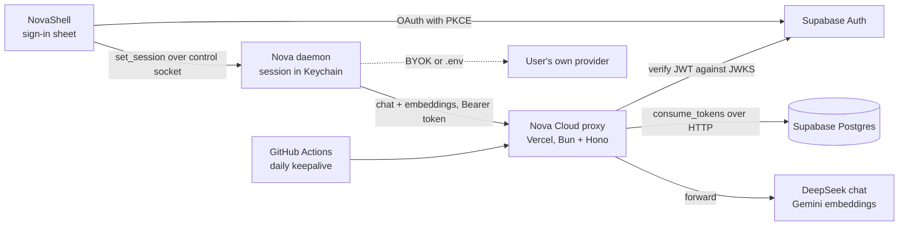

# Nova Cloud and accounts: design

**Status:** approved 2026-10-21, not built. **Replaces:** D28's "no account and
no relay in M2". **Features:** F6.2 (sign-in step), F6.5 (backend choice).

Nova Cloud lets a person download Nova, sign in, and have it work without an
API key of their own. This document covers the first of five projects in the
order agreed on 2026-10-21:

1. **Accounts and Nova Cloud** (this document).
2. BYOK: provider keys entered in the app and kept in the Keychain.
3. Onboarding (F6.2), built on 1 and 2.
4. Audio capture.

Calls marked *(builder's call)* were made during design and can be changed
without asking again. Everything else was decided by the owner.

## Why

Nova is mainly a portfolio project. The person most likely to try it is a
recruiter with ten minutes, no API key and no wish to read a setup guide.
Today Nova needs a hand-edited `.env` before it does anything. Nova Cloud
removes that step.

Every Nova Cloud call is paid for by the owner. Cost control is therefore a
design goal, not an afterthought.

## Goals

- A new user signs in and Nova processes captures with no key of their own.
- The server never stores captured text, memories, or loops.
- Per-account daily caps and an overall monthly ceiling, enforced on the
  server.
- Paid plans can be added later as data, not as a redesign.
- BYOK and `.env` keep working.

## Non-goals

- Paid plans, billing, or Stripe.
- A second Mac, sync, or remote MCP (F3.2).
- Sign in with Apple. The Apple Developer Program now arrives with this
  project (DeviceCheck needs it), so it can follow soon after.
- Email-link sign-in. Supabase's built-in mail reaches only the project's own
  team and a few messages an hour; public email links need a custom SMTP
  service such as Resend. Added later. *(Builder's call.)*
- The BYOK key screen and onboarding. Those are the next two projects.

## Anti-goals

These would make the work a failure even if it ran:

- **Free features that belong behind a paywall.** Nova will have paid plans.
  Unlimited Nova Cloud is the most obvious paid feature, so the free plan has
  a cap from the first day.
- **A free general-purpose AI API.** A session token must not buy arbitrary
  model calls.
- **Captured text kept on a server or written to a server log.**
- **An unbounded bill.** One popular post must not be able to cost more than
  the ceiling.

## Privacy wording

The claim is about storage, not processing. Captured text already leaves the
Mac today, to whichever provider `.env` names. The onboarding claim lines in
`design/design-system.md` were rewritten to say only what is true:

- "Your memory is stored only on this Mac, encrypted"
- "Text goes out only to be processed, never kept"
- "Screenshots are never saved or sent"

The second line is a promise Nova Cloud must keep: no request body is stored or
logged by the proxy, and the upstream accounts the owner configures must be
on terms that neither keep inputs nor train on them. With BYOK, Nova names
the user's provider and defers to its terms.

`privacy.md` and the README gain a row: with Nova Cloud, text goes through
Nova's server to DeepSeek and Gemini and is not kept by Nova.

## Architecture

| Piece | Choice | Reason |
|---|---|---|
| Sign-in | Supabase Auth: GitHub and Google | Managed login avoids writing auth by hand. Free for 50k monthly users. Tokens verify without a database call. |
| Database | Supabase Postgres | Same project as sign-in. The data is tiny. |
| Proxy | Bun + Hono on Vercel | Same runtime and test runner as the daemon. Vercel bills active CPU, not time spent waiting on the model. Nothing to keep running. |
| Models | Set by the proxy's environment; DeepSeek chat and Gemini embeddings to start | The owner configures the upstream accounts. Loop precision was measured on this pair, so changing it means new paid eval runs. |
| Device check | Apple DeviceCheck (`DCDevice`) | Proves a request comes from a real Mac running Nova's signed build. Available from macOS 10.15; Nova already requires macOS 14. |
| Keepalive | GitHub Actions, daily | Supabase pauses a free project after a week with no requests. |

### Nova Cloud is an OpenAI-compatible proxy

The daemon already talks to OpenAI-compatible providers
(`OpenAICompatProvider`). Nova Cloud is one more: its base URL is the proxy
and its API key is the user's current access token.

This keeps three things true:

- BYOK and Nova Cloud share one code path.
- Prompts, email and phone redaction (`redactSecrets`), and the four
  `parseLoops` gates stay in the open-source client. The server sees exactly
  what a BYOK provider sees, already redacted.
- The server is small: verify, check the cap, forward, count.

## Signing in

1. The shell opens Supabase's hosted sign-in in an
   `ASWebAuthenticationSession` sheet, with PKCE.
2. Supabase redirects to `nova://auth/callback`. The shell registers that URL
   scheme.
3. The shell sends the session to the daemon with a new control op,
   `set_session`. The shell does not keep it. This follows the rule that only
   daemon-side code holds secrets.
4. The daemon stores the refresh token in the Keychain under the existing
   service `dev.nova.keys`, account `session`, through `keychain.ts`.
5. `sign_out` deletes that item and returns the daemon to "no provider".

**One refresh at a time.** Supabase rotates the refresh token on every use, so
two processes refreshing at once would invalidate each other. Both the daemon
and `nova mcp` may refresh, because `nova mcp` must keep working when the app
is not running and an access token lasts about an hour. A refresh takes an
exclusive lock file next to the control socket, re-reads the Keychain inside
the lock, refreshes only if the stored access token is still near expiry, and
writes both tokens back before releasing. *(Builder's call.)*

### A different account clears this Mac's memory

The store belongs to one account. Signing in with a different account deletes
everything Nova has stored on this Mac first, after a warning.

- The daemon records which account the store belongs to:
  `store_metadata.account`, a `lookupDigest` of the Supabase user id, never
  the id in the clear, and `store_metadata.account_email`, encrypted with
  `encryptField`, so the warning can name the previous account.
- `set_session` with the same account: no change. Signing out never deletes
  anything, so signing back in as the same person keeps everything.
- `set_session` with a different account: refused with `account_mismatch`,
  the previous account's masked email, and the counts from `count_for_delete`
  for scope `everything`. Nothing is deleted and the session is not stored.
- The shell then shows the warning:

  > **This Mac's memory belongs to another account**
  >
  > Nova on this Mac was last signed in as **a•••@gmail.com**. Its memory
  > stays with that account and is not carried over.
  >
  > Signing in as **sam@example.com** deletes everything Nova has stored on
  > this Mac: **{n} memories** and **{m} open loops**, captured since
  > {first capture date}. This can't be undone.
  >
  > To keep it, cancel and sign in as a•••@gmail.com instead.

  Buttons: **Cancel** (default) and **Delete and sign in** (destructive).
  The previous email is masked to its first letter and domain, because the
  person signing in may not be the person whose memory it is.
  *(Builder's call: the masking rule.)*
- On confirm, the shell sends `set_session` with `replaceStore: true`. The
  daemon runs the existing `delete_data` path for `everything` (the same one
  Your data uses, which F5.3 tests), then binds the store to the new account
  and stores the session, in that order. If the delete fails, the session is
  not stored.
- **The first sign-in claims an unbound store** without deleting it, so data
  captured before sign-in, or before this feature existed, is kept.
  *(Builder's call.)*
- The device key and its DeviceCheck registration are untouched; the daily
  cap stays per device.

## Provider resolution

The existing order gains a stored mode:

1. Any of the six `NOVA_*` variables: OpenAI-compatible, as today. This is
   the developer path and it is unchanged.
2. `GEMINI_API_KEY`: Gemini, as today.
3. Stored mode `cloud` with a session: Nova Cloud.
4. Stored mode `byok`: the user's keys from the Keychain (project 2).
5. Otherwise a provider that throws `NotSignedIn`.

The mode lives in `store_metadata`, like `user_identity`.

**Signed out, the daemon still runs.** Today `nova start` exits 1 when no
provider is configured, which would leave no control socket for the shell to
send `set_session` to. Instead the daemon starts, capture runs, and
`NotSignedIn` is handled like `ProviderUnreachable`: no attempt spent, the
queue waits, and the drain resumes on `set_session`. A probe failure for any
other reason (a bad key, a dead endpoint) still exits 1 as today. Whether
capture may run before onboarding finishes is a consent question for the
onboarding project, not this one. *(Builder's call.)*

For Nova Cloud the start probe is `GET /v1/usage`, which costs nothing.

## The proxy

Lives in `cloud/` in this repository. It is open source like the rest; secrets
are Vercel environment variables.

The upstream is set entirely by environment, mirroring the daemon's six
variables: a base URL, key and model each for chat and embeddings. The owner
sets them up. The Supabase service key, the JWKS URL, the DeviceCheck key and
key id, the price table and the monthly ceiling are environment variables
too.

### Endpoints

| Endpoint | Purpose |
|---|---|
| `POST /v1/chat/completions` | OpenAI chat format |
| `POST /v1/embeddings` | OpenAI embeddings format |
| `GET /v1/usage` | `{ plan, usedToday, capToday, resetsAt }` for the app |
| `POST /v1/devices` | Registers a device key with a DeviceCheck token |
| `GET /health` | Touches Supabase. Used by the keepalive. |

### What it refuses

- A missing, expired, or invalid token: 401.
- `stream: true`: 400. The daemon never streams.
- A body over a fixed size: 413.
- A chat request whose shape is not Nova's: anything but exactly one `user`
  message, `temperature` other than 0, or no JSON `response_format`: 400.
- An embeddings request over a fixed number of inputs or characters: 400.
- `max_tokens` is clamped. The model name from the client is ignored and the
  server's model is used.

**Abuse is bounded, not impossible.** The shape checks stop casual use as a
chat API without moving prompt knowledge onto the server, which would break
the rule that Nova Cloud sees exactly what a BYOK provider sees. A determined
user can still fit those checks; the daily cap is what bounds the cost.
*(Builder's call.)*

### Per request

1. Verify the JWT against Supabase's JWKS. No database call.
2. Read the remaining allowance for this device and IP. If none is left,
   return 429 (see Limits). A request with no device key is refused: 400.
3. Forward to the upstream.
4. Read the token counts from the upstream response's `usage` field.
5. Call `consume_tokens(user, device, in, out, cost)`.
6. Return the upstream response unchanged.

The proxy reaches Postgres through Supabase's HTTP API, never a direct
connection: short-lived serverless instances would exhaust Postgres
connections.

**Logging:** user id, endpoint, token counts, status, duration. Never a
request or response body.

**Tests:** `bun test` against a fake upstream and a test Supabase project.
*(Builder's call: a local Supabase via its CLI, or a mocked HTTP layer.)*

## Data model

SQL migrations in `cloud/supabase/migrations/`.

| Table | Columns |
|---|---|
| `plans` | `name` PK, `daily_token_cap` |
| `accounts` | `user_id` PK → `auth.users`, `plan` → `plans` default `new`, `created_at` |
| `devices` | `device_hash` PK, `registered_at`, `blocked`; and `account_devices` (`user_id`, `device_hash`) |
| `ip_daily` | `ip_hash`, `day`, `signups`, `requests`; PK (`ip_hash`, `day`) |
| `usage_daily` | `device_hash`, `day`, `tokens_in`, `tokens_out`, `requests`; PK (`device_hash`, `day`). The cap is per device, so a second account on one Mac shares it. |
| `spend_monthly` | `month` PK, `cost_micros` |

`consume_tokens(user, device, in, out, cost)` adds to `usage_daily` and
`spend_monthly` in one statement each, inside one function, and returns the
remaining daily and monthly allowance. An `accounts` row is created on first
request if absent.

Row-level security denies all client access. Only the proxy writes, with the
service-role key.

Cost is estimated from token counts and a price table held in the proxy's
environment, so a price change needs no deploy.

## Limits

| Limit | Default | When reached |
|---|---|---|
| Daily cap, `new` plan (first 7 days) | 100,000 tokens per device *(builder's call)* | Same as below |
| Daily cap, `free` plan | 1,000,000 tokens per device *(builder's call)* | 429, `Retry-After` until the next 00:00 UTC |
| Monthly ceiling, all users | $20 *(builder's call)* | 429 for everyone, `Retry-After` 3600 |
| Upstream | Hard limits in the DeepSeek and Gemini dashboards | Backstop if the proxy miscounts |

**The daemon needs no new code for either 429.** `QuotaExhausted` already reads
`Retry-After`, and `QuotaGate` pauses both chat and embeddings, spends no
attempt, and keeps captures queued.

**Where the defaults come from.** The owner's own log shows about 11,500
characters per chat call, roughly 3,000 tokens. 1,000,000 tokens is about 300
captures with new text, a few hours of active use. Both numbers live in data
(`plans`, an environment variable) and should be revised after one week of
real traffic through the proxy, which records exact counts.

### Integrity: a modified client is rejected

The server must reject any request that does not come from Nova's own,
unmodified, signed build on a real Mac. Three layers make that checkable.

**1. Nothing runs unsigned.** The daemon moves inside the app bundle as a
single compiled binary (`bun build --compile`), signed with the Developer ID
team and the hardened runtime, like `nova-capture` already is. Editing any
file in the bundle breaks its code signature and macOS refuses to launch it.
This pulls the bundled-daemon half of D27 forward into this project. A
daemon run from a source checkout (`bun src/cli.ts start`) can still use BYOK
and `.env`, never Nova Cloud.

**2. Apple App Attest on every request.** `DCAppAttestService` is available
from macOS 11.

1. On first sign-in the shell generates an App Attest key in the Secure
   Enclave and has Apple attest it. The attestation proves the key belongs
   to Nova's App ID (team and bundle id) running on genuine Apple hardware.
   `POST /v1/devices` sends it with the DeviceCheck token.
2. The proxy verifies the attestation against Apple's App Attest root
   certificate once, and stores the key's public key and a counter.
3. Every Nova Cloud request carries an **assertion**: a signature by that key
   over a hash of the exact request body, the path and a timestamp. The
   daemon asks the shell for it over the control socket. Before signing, the
   shell checks that the peer process on the socket is the bundle's own
   signed daemon, by its code signature, not by its path.
4. The proxy rejects with 401 any request whose assertion is missing, does not
   verify against the stored key, signs a different body, or does not raise
   the counter. A replayed or edited request fails.

So the chain is: Apple vouches for the shell, the shell vouches for the
daemon by code signature, and the proxy checks the signature on every body.
A modified daemon cannot get an assertion. A modified or re-signed shell has
a different signing identity and cannot use Nova's App Attest key.

**3. The local store detects tampering.** SQLCipher authenticates every page
with an HMAC, and every encrypted field is AES-256-GCM, which carries its own
authentication tag. An edited database file fails to decrypt. The daemon then
refuses to use the store, reports "Nova's store is damaged" instead of
reading on, and makes no Nova Cloud call until the user deletes or restores
it. The server never receives the store, so this check is local by nature:
what the server checks is the client that would read it.

**What this cannot promise.** A person with full control of their own Mac,
including disabling System Integrity Protection and reverse-engineering the
binaries, can in principle defeat any client-side check. These layers make
that require a real Mac and serious effort, and the per-device caps bound
what such a person gets. No design that runs on the user's machine can
honestly claim more.

**To prove before building on it** (a short spike, first in the plan):
- `isSupported` is true on Apple Silicon and on Intel Macs with a T2 chip, and
  what happens on older Intel Macs. Those get BYOK only.
- A Developer ID app outside the Mac App Store can use App Attest. It needs
  the App Attest entitlement and an embedded provisioning profile.
- A process can verify its socket peer's code signature from its audit token.

### Sign-up and abuse

Sign-up is open: anyone with a GitHub or Google account can start. Open
sign-up means one person can create many accounts, so a free allowance is tied
to more than the account. Four layers, cheapest first:

1. **OAuth only.** No email sign-up, so each account costs a real GitHub or
   Google identity.
2. **A smaller cap for new accounts.** The `new` plan applies for the first 7
   days, then the account moves to `free`. *(Builder's call: 7 days, and the
   `new` cap at one tenth of `free`.)*
3. **Per-IP limits.** On account creation and on proxy requests, counted in
   Postgres per day, plus Vercel's firewall rate limits as a backstop.
4. **A device key, registered with Apple DeviceCheck.** See below.

### Device registration

A random device key alone stops honest account-switching but not a script:
the client is open source, so a script can mint a key per request, and a user
can delete the Keychain item. DeviceCheck closes that gap. Apple signs a
token that only a real Mac running Nova's signed build can produce, and keeps
two bits per device that the user cannot reach.

1. On first launch the daemon generates a random device key and keeps it in
   the Keychain (`dev.nova.keys`, account `device`).
2. The shell asks `DCDevice.current.generateToken()` and sends the token with
   the device key's hash to `POST /v1/devices`. The shell, not the daemon,
   because only the signed app process can produce the token.
3. The proxy validates the token with Apple's DeviceCheck API, then reads the
   device's two bits:
   - **bit 0 unset:** a new Mac. Set bit 0, store the device hash.
   - **bit 0 set, last updated in an earlier month:** a reinstall or a wiped
     Keychain. Allowed; store the new hash.
   - **bit 0 set, updated this month:** refused. One Mac gets at most one new
     device key a month. *(Builder's call.)*
   - **bit 1** marks a device the owner has blocked by hand.
4. Every proxy request carries the device key. An unregistered key gets 403.
   Apple is called only at registration, not per request.

Daily usage is counted per device, so accounts on one Mac share one
allowance. The device hash is not linked to any content; `privacy.md` names
it and the DeviceCheck bits.

**Consequences.**
- **Nova Cloud needs the Apple Developer Program now.** The DeviceCheck API
  key (a `.p8` file) comes from it, and only an app signed with that team can
  produce tokens. The paid program was planned for the signed build (D27); it
  becomes a prerequisite of this project. Sign in with Apple can then come
  early too.
- **A build from source cannot use Nova Cloud.** It has no valid DeviceCheck
  token. Such users bring their own keys (BYOK), which is the natural path for
  someone building from source.
- Apple's bits are reported to persist across reinstalls, but one developer
  forum report says otherwise in the development environment. Verify in
  production before relying on the reinstall rule.

**The ceiling must sit below Vercel's Hobby limits.** Exceeding a Hobby limit
can pause the project for up to 30 days. Nova's own 429 must come first.

## Free-plan limits

| Service | Limit | Risk |
|---|---|---|
| Supabase Free | 500 MB database, 5 GB egress, 50k monthly users, paused after a week idle, no backups | Low. The keepalive prevents the pause. Losing accounts would force sign-ups again, but no memory data lives there. |
| Vercel Hobby | 1M invocations, 4 CPU-hours, 360 GB-hours provisioned memory a month, 300 s max duration, non-commercial only | Memory is the likeliest limit, because it accrues while waiting on the model. Measure it. Charging money requires Pro. |

Bun on Vercel is in public beta. If it misbehaves, Hono runs on Vercel's Node
runtime unchanged.

## Changes on the Mac

**Shell**

- Device registration: the `DCDevice` token and the App Attest attestation to
  `POST /v1/devices` at first sign-in, and again if the device key changes.
- Request assertions: an App Attest signature over each Nova Cloud request
  body, given only to the bundle's own signed daemon.
- The account-switch warning.
- An Account pane in Your Space: sign in, sign out, the signed-in email, and
  today's usage from `GET /v1/usage`. Onboarding reuses this flow later.
- The `nova://` URL scheme in the app's `Info.plist`.

**Daemon**

- Built as a signed, compiled binary inside the bundle (see Integrity).
- Refuses a store that fails to decrypt, and reports it.
- Control ops `set_session`, `sign_out`, and `account` (signed-in email, mode).
  Each refuses invalid input rather than coercing it (bug class 9).
- Session storage and refresh.
- The device key: generated once, kept in the Keychain, sent with every Nova
  Cloud request.
- A Nova Cloud provider: `OpenAICompatProvider` with a token source instead
  of a fixed key.
- The stored provider mode.

**Docs**

- `privacy.md`, README, `providers.md`: the Nova Cloud path.
- `decisions.md`: D28 superseded.
- `features.md`: F6.2 and F6.5 progress.

## Paywall check

- The cap is a column on `plans`. A paid plan is a new row with a larger cap.
- Nothing else Nova Cloud does is free by accident.
- A sign-in required for BYOK cannot be enforced in an open-source client.
  It is kept for a user count and an easy path to Nova Cloud, not as
  protection.

## Left to the builder

- Hono route structure, the token-source interface, and the refresh timer.
- Where the access token is shared with `nova mcp`.
- The exact `max_tokens` clamp and body-size limit.
- Test setup for the proxy.
- Account pane layout, within `design/design-system.md`.
